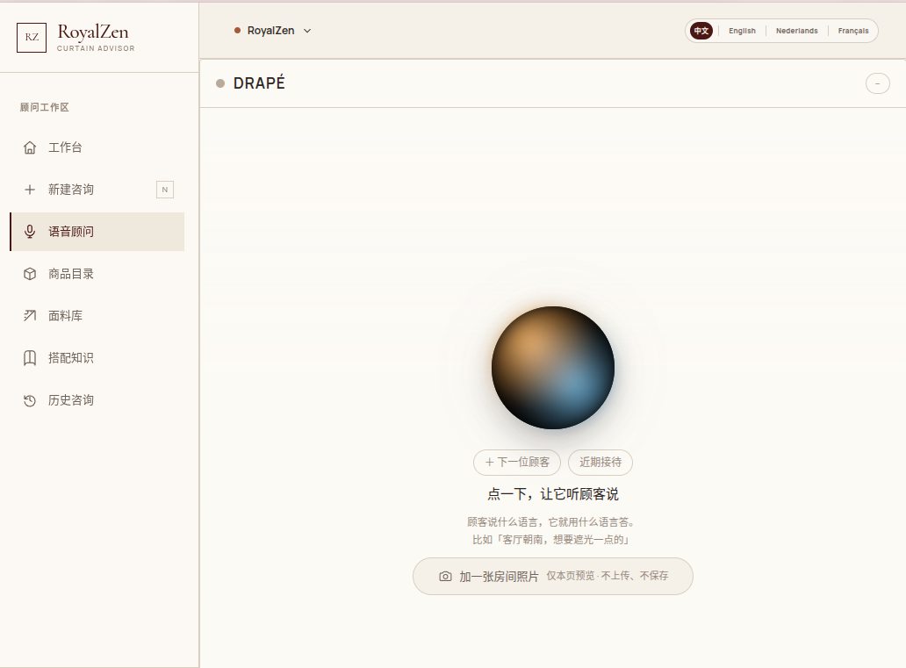
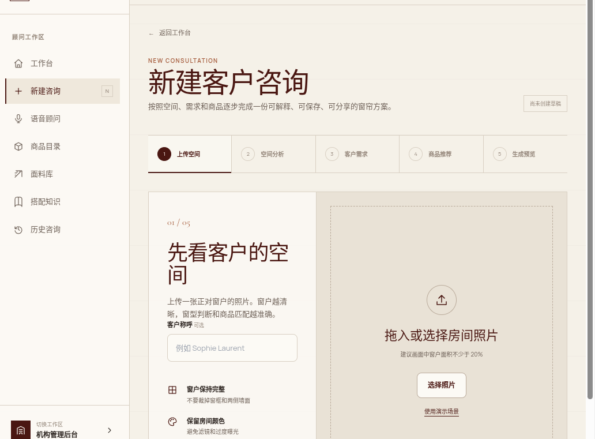

# RoyalZen AI Curtain Advisor

**面向窗帘门店的多模态智能导购系统。** 以语音交流为入口，结合房间照片和客户偏好，辅助店员完成商品筛选、搭配建议和方案展示。

项目来自实习期间参与的门店导购场景。针对客户难以想象安装效果、选品依赖店员经验的问题，将需求采集、商品匹配和视觉预览串成一套接待流程。

## 业务流程

```text
语音接待 / 新建咨询
        ↓
房间照片 + 客户偏好
        ↓
空间分析 → 商品筛选与推荐
        ↓
搭配预览 → 方案分享 → 人工量尺与报价
```

系统提供两种使用方式：客户与语音顾问直接交流，或由店员按步骤创建咨询。两种方式围绕同一套商品与咨询数据组织服务。

## 界面展示

### 01 · 语音接待

语音顾问 DRAPÉ 是门店接待入口。客户可以描述房间、采光和偏好，店员也可以补充房间照片。界面支持中文、英文、荷兰语和法语，并提供“下一位顾客”和“近期接待”入口。



*截图为本地语音界面展示；当前照片功能为本页预览，实际通话需要配置语音服务。*

### 02 · 创建客户咨询

咨询按“上传空间 → 空间分析 → 客户需求 → 商品推荐 → 生成预览”分步展开。上传入口提示保留完整窗户和房间颜色，帮助店员采集适合分析的照片。



*截图展示咨询创建的第一步；后续分析、推荐和保存需要数据库及相应服务。*

### 03 · 展示客户方案

客户方案页集中展示搭配效果、推荐商品和选择理由，方便店员向客户解释方案，并继续安排看样、量尺和报价。


*截图来自内置静态方案样例，商品名称、遮光比例和搭配效果均为示例内容，不代表本次实时推荐或生成结果。*

## 核心功能

| 模块 | 主要内容 |
|---|---|
| 语音导购 | 实时对话、偏好采集、商品卡片、照片入口及转人工工具 |
| 空间与需求分析 | 房间照片、窗型判断、颜色分析及客户偏好问卷 |
| 商品推荐 | 从 SKU 目录筛选候选，结合配色约束、多样性选择和模型重排生成建议 |
| 效果预览与分享 | 结合房间和商品参考生成搭配预览，组织客户方案与分享页面 |
| 咨询管理 | 客户咨询、接待记录和方案历史 |
| 机构后台 | 商品、面料、知识库、员工邀请与角色管理 |

## 实现重点

- **规则与模型配合选品：** 先按偏好、配色等条件缩小商品池，再将最多 40 款候选交给模型排序和解释，避免直接把全量目录塞入提示词。
- **推荐结果可校验：** 校验商品编号，对缺乏数据支持的性能声称做约束；模型超时或解析失败时保留降级路径。
- **语音与页面协同：** 将照片、商品卡片和点击事件纳入会话上下文，复用商品检索与颜色词表。
- **业务数据留在服务端：** 通过服务端访问 PostgreSQL，以机构成员角色控制业务权限，浏览器使用 Supabase 的公开配置完成身份验证。

更多实现说明见 [系统架构](docs/ARCHITECTURE.md)。

## 技术栈

| 层级 | 技术 |
|---|---|
| 前端与 API | Next.js 15 App Router、React、TypeScript、Tailwind CSS |
| 身份与权限 | Supabase Auth、机构成员角色、管理员 MFA |
| 业务数据库 | PostgreSQL |
| 图片存储 | Cloudflare R2 / S3 兼容接口 |
| 空间理解与推荐 | Qwen / Kimi，结合规则筛选与 MiniMax 重排 |
| 实时语音 | OpenAI Realtime API |
| 效果图 | Seedream |

以上为代码中的技术集成。公开展示版不附带原业务数据库、服务密钥或生产部署配置。

## 本地运行

建议使用 **Node.js 24 LTS**。

```bash
npm ci
cp .env.local.example .env.local
npm run dev
```

Windows PowerShell 可使用 `Copy-Item .env.local.example .env.local` 复制配置。

启动后访问 [http://localhost:3000](http://localhost:3000)。默认展示模式会进入静态客户方案页。

| 路由 | 页面 |
|---|---|
| `/app/voice` | 语音顾问 |
| `/app/consultations/new` | 新建咨询 |
| `/share/demo` | 静态客户方案样例 |
| `/app` | 顾问工作台 |
| `/app/history` | 咨询历史 |
| `/admin` | 机构后台 |
| `/login` | 登录页面 |

默认配置可查看语音、咨询创建和静态方案界面；语音页照片仅在当前页面预览。完整业务流程需另行配置数据库、图片存储、模型服务及登录。数据库脚本包含部分建表逻辑和增量迁移，不是原业务库的完整备份。

Linux 若出现 `EMFILE / too many open files`，可临时使用 `WATCHPACK_POLLING=1000 npm run dev`。

## 检查与说明

```bash
npm run typecheck
npm run lint
npm run test:unit
```

导航性能测试需要生产构建和可用数据库。其他脚本的用途见 [脚本说明](scripts/README.md)。

- [数据与素材说明](docs/DATA_AND_ASSETS.md)：样例数据来源、素材范围及缺失的数据。
- [目录导览](docs/PROJECT_STRUCTURE.md)：代码和文档的组织方式。
- [截图说明](docs/images/README.md)：截图文件与更新方式。
