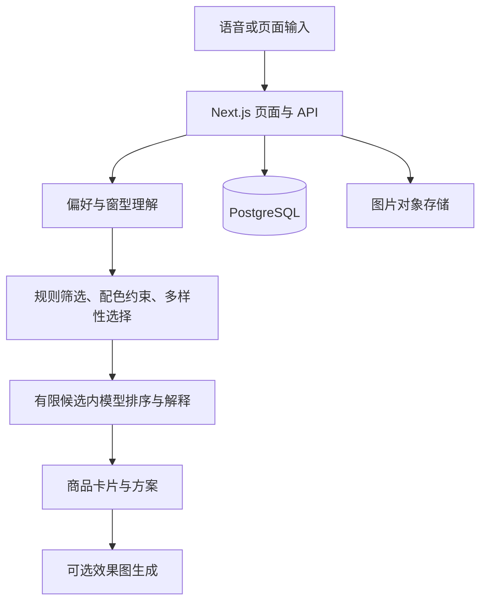

# 技术说明

## 产品流程

客户描述偏好、提供房间照片；店员或语音顾问展示推荐；需要时生成预览并分享方案；最终量尺、报价和安装由人工确认。

## 推荐边界

图像处理模块提取房间的颜色、亮度和冷暖，评估取色可信度；商品先经过偏好与配色规则，再抽样形成最多 40 款候选。重排模块在候选内选择并解释，避免让模型直接遍历整个目录。SKU 编号、无依据的性能声称等需要校验，超时或解析失败可降级。

代码的部分规则来自历史商品数据分布，公开版未携带原库；不能据此承诺在任意商品目录上有相同效果。

## 语音交互

语音页面负责连接、字幕、卡片、照片及点击事件；服务端铸造临时凭证并执行工具。会话记录与客户咨询分开保存。商品检索和颜色词表尽量复用同一实现，以减少语音和页面返回不一致的情况。

真实语音还依赖数据库中的 sales_instructions、知识和业务配置，以及服务商账号支持。源码中模型名称和接口参数保留原实现，本次没有验证外部模型调用。

## 工程取舍

- 数据库访问在服务端执行，机构角色作为业务权限依据。
- 连接失效和连接池耗尽分别处理，避免对 SQL 错误盲目重试。
- 目录缓存、图片缩略图和路由加载反馈改善页面等待体验。
- 价格与遮光等没有可信数据的属性，不通过话术补齐。
- 本机展示模式明确区分“照片预览”和“已上传保存”。

## 展示模式

LOCAL_DEMO_PREVIEW=1 时，根页面进入静态样例；语音页的图片使用浏览器对象 URL，仅留在页面内存。此分支不会创建咨询、上传图片或向模型注入照片。关闭展示模式后恢复原服务端链路。

生产部署、真实鉴权、迁移兼容性和模型可用性需在实际环境重新验证。
